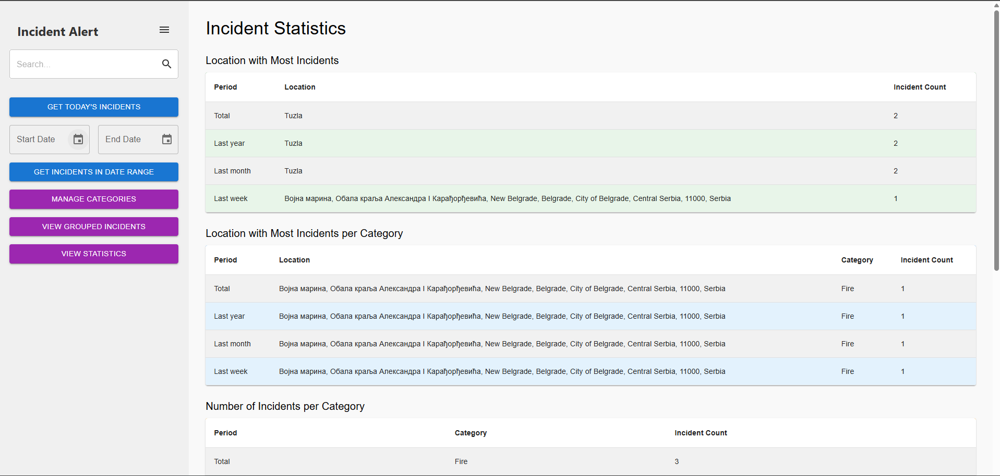

<div align="center">

# 🛠️ Incident Alert Management Frontend


<picture>
    <source srcset="readme_assets/demo.gif" type="image/gif">
    
</picture>

</div>

---

## 📌 Project Overview

**Incident Alert Management Frontend** is the moderator-facing React application for the Incident Alert system. Moderators review, approve, reject, or delete reported incidents, view statistics, and explore ML-grouped incident clusters — all on an interactive map.

---

## ✨ Features

- 🔍 **Incident Verification** — Approve, reject, or delete reported incidents
- 📊 **Statistics Overview** — View incident statistics by location, category, and time period
- 🤖 **ML Incident Grouping** — Browse incidents grouped by text similarity using machine learning
- 🗺️ **Interactive Map** — Leaflet/OpenStreetMap interface for locating and managing incidents
- 🔐 **Authentication** — Login via username/password or OAuth with student email (`@student.etf.unibl.org`)
- 🌐 **Google Translate** — Translation support for multi-language incident descriptions
- 📍 **Location Search** — Google Places integration for location searching

---

## 🛠️ Tech Stack

| Technology | Usage |
|------------|-------|
| React | Frontend framework |
| Redux | State management |
| Leaflet / OpenStreetMap | Interactive map (no API key required) |
| JWT | Session authentication |
| Google OAuth | Student email login |
| Axios | HTTP client |
| Docker + Nginx | Containerized deployment |

---

## 🚀 Setup & Run

### Prerequisites
- Docker and Docker Compose
- Backend services running (see [IncidentAlert](https://github.com/pero-grubac/IncidentAlert))

### 1. Clone the repository
```bash
git clone https://github.com/pero-grubac/IncidentAlertFrontend-Mangement.git
cd IncidentAlertFrontend-Mangement
```

### 2. Configure environment

Set service URLs in `src/environments/config.production.json`:
```json
{
  "baseServiceUrl": "http://localhost:5002",
  "mlServiceUrl": "http://localhost:5004",
  "statisticsServiceUrl": "http://localhost:5006",
  "REACT_APP_GOOGLE_API_TOKEN": "",
  "REACT_APP_GOOGLE_API_KEY": ""
}
```

> Google API keys are optional — map works without them. Only Places autocomplete, Translate, and OAuth require them.

### 3. Run with Docker
```bash
docker compose up -d --build
```

App will be available at `http://localhost:3001`.

### Default credentials

| Role | Username | Password |
|------|----------|----------|
| Moderator | moderator | Admin123! |