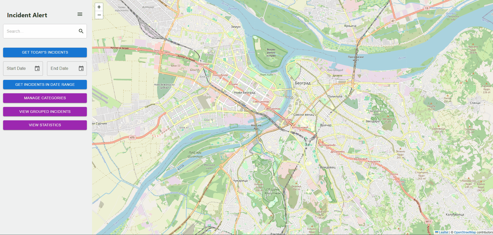
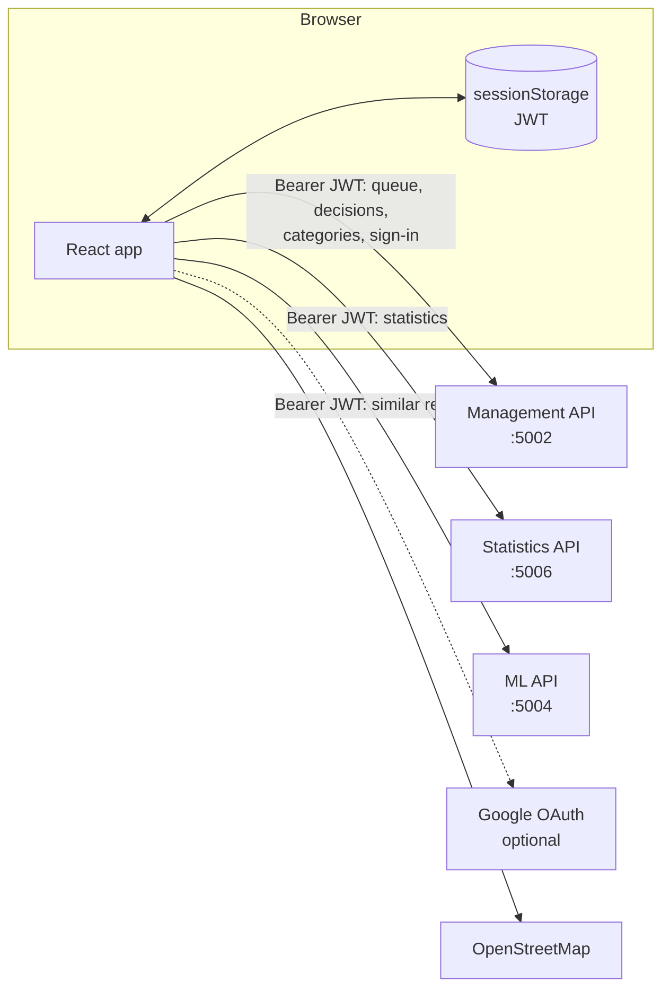
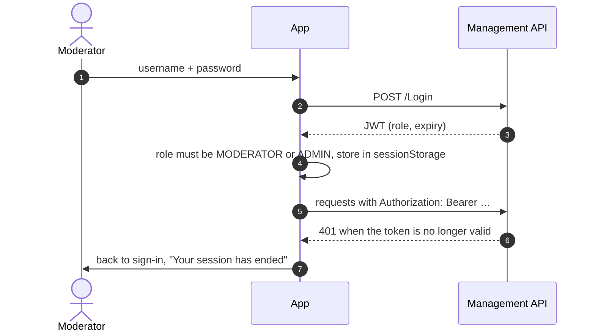

<div align="center">

# 🛡️ Incident Alert — Moderation

[](https://github.com/pero-grubac/IncidentAlertFrontend-Mangement/actions/workflows/ci.yml)


**The moderators' workspace: review citizen reports on a map, publish or reject them, and see the patterns.**



</div>

---

## 📌 Project Overview

The moderation web app of **Incident Alert**. Every report a citizen sends from the [public app](https://github.com/pero-grubac/IncidentAlertFrontend) lands in a queue here. A moderator reviews it on the map and either **approves** it (it is published to the public map), **rejects** it, or **deletes** it. The app also shows statistics and groups of similar reports found by machine learning.

It talks to three services from the [backend repository](https://github.com/pero-grubac/IncidentAlert): Management (queue, auth, categories, accounts), Statistics and ML. All three accept the same JWT.

---

## ✨ Features

- 🔐 **Sign-in** with username and password (JWT), or with Google for student accounts when a client ID is configured; moderators and administrators get in, and an expired session signs out on its own
- 🧑‍💼 **Accounts** (administrators): new accounts wait for approval; approve, revoke or delete them in one place
- 🗺️ **Queue on the map**: pending reports pinned where they happened, with a list beside them; nearby places cluster when zoomed out
- 🔥 **Hot spots**: a heat-map layer of published incidents, one click away on the map
- ⚖️ **One-click decisions**: approve & publish, reject (and back to pending), or delete after a confirmation — with the photos (← → to browse) and a mini map of where it happened
- 📅 **Filters** by period (all, today, 7 days, 30 days, custom) and status (pending, rejected)
- 🏠 **Place page** with every report for one place, filterable by category, status and date
- 📊 **Statistics**: busiest place overall and in the last month, most reported category, hot spot per category, reports per day for 30 days, a hot-spot map, and incidents per category and period — every category in its own color
- 🤖 **Similar reports**: ML.NET clusters of published incidents, largest first, with the words they share
- 🏷️ **Categories**: add, rename inline, delete with confirmation; changes reach the public app through the message bus
- 📝 **Registration** with the same password policy as the API, checked before sending; the new account waits for an administrator
- 🌍 **Serbian (Latin) and English**, 🌙 **light, dark or system theme**, and a 📱 **phone layout** where the queue becomes a bottom sheet

---

## 🛠️ Tech Stack

| Technology | Usage |
|------------|-------|
| React 18 | UI |
| Vite 6 | Dev server and production build |
| MUI 6, MUI X Date Pickers, MUI X Charts | Components, theme, pickers, bar chart |
| Leaflet + React Leaflet | Moderation map, mini maps |
| react-leaflet-cluster, leaflet.heat | Clustering and the hot-spot layer |
| React Router 6 | Routing with guarded routes |
| Axios | API clients with a bearer-token interceptor |
| jwt-decode | Reading the role and expiry from the token |
| @react-oauth/google | Optional Google sign-in (Google Identity Services ID token) |
| Vitest + Testing Library | Unit and component tests |
| ESLint 9 | Linting |
| Docker + nginx | Production image |

---

## 📁 Project Structure

```
src/
├── api/              session storage, axios clients, all endpoints
├── components/
│   ├── map/          ModerationMap, SVG markers, tile layer settings
│   ├── AppLayout.jsx         navigation drawer and user card
│   ├── IncidentReviewDialog.jsx   approve / reject / delete
│   └── IncidentCard.jsx, QueueListItem.jsx, StatusChip.jsx …
├── context/          AuthContext, QueueContext, Appearance (theme), notifications
├── i18n/             translations (sr, en), plural rules, language switch
├── lib/              statuses, account roles, insights (chart data, ML keywords), password policy, dates, geocoding …
├── pages/
│   ├── auth/         LoginPage, RegisterPage, Google button
│   ├── MapPage.jsx, LocationPage.jsx
│   └── CategoriesPage.jsx, GroupedIncidentsPage.jsx, StatisticsPage.jsx, UsersPage.jsx
├── test/             test setup, render helper, fake tokens
├── config.js         build-time settings (VITE_*)
└── theme.js          design tokens and MUI theme
```

---

## 🚀 Setup & Run

### Prerequisites
- Node.js 22 (20.19 or newer)
- The backend running — see [IncidentAlert](https://github.com/pero-grubac/IncidentAlert) (`docker compose up -d --build`)

### 1. Clone and install
```bash
git clone https://github.com/pero-grubac/IncidentAlertFrontend-Mangement.git
cd IncidentAlertFrontend-Mangement
npm ci
```

### 2. (Optional) Configure
```bash
cp .env.example .env.local
```

| Variable | Default | Purpose |
|----------|---------|---------|
| `VITE_API_URL` | `http://localhost:5002` | Management API |
| `VITE_ML_URL` | `http://localhost:5004` | ML API |
| `VITE_STATISTICS_URL` | `http://localhost:5006` | Statistics API |
| `VITE_GOOGLE_CLIENT_ID` | empty | Shows "Continue with Google" |
| `VITE_GOOGLE_API_KEY` | empty | Enables translation of reports |

### 3. Start
```bash
npm run dev
```

The app runs on **http://localhost:3001**, the origin the APIs allow through CORS. Sign in with the demo moderator **`moderator` / `Admin123!`**, or as **`admin` / `Admin123!`** to also see **Accounts**.

### Run with Docker
```bash
docker compose up -d --build
```

The image is built with the `VITE_*` values from your shell or `.env` and served by nginx on port 3001.

### Scripts

| Command | What it does |
|---------|--------------|
| `npm run dev` | Dev server with hot reload |
| `npm run build` | Production build into `dist/` |
| `npm run preview` | Serve the production build locally |
| `npm run lint` | ESLint |
| `npm test` | Run the tests once |
| `npm run coverage` | Tests with a coverage report |

---

## 📖 Usage

1. **Sign in** as a moderator. You land on **Map & queue** with every pending report.
2. **Review.** Click a report in the list or a pin's popup. Read it, look at the photos, then:
   - **Approve & publish** — it leaves the queue and appears in the public app,
   - **Reject** — it stays in the queue as rejected (and can go back to pending),
   - **Delete** — it is removed with its photos, after you confirm.
3. **Filter** the queue by when it was reported and by status, or search an address to move the map.
4. **Hot spots** (top right of the map) overlays where published incidents cluster. **Statistics** shows where and what is reported most, day by day. **Similar reports** shows the ML groups, useful for spotting duplicates.
5. **Categories** controls what citizens can choose when they report.
6. **Accounts** (administrators only) lists new accounts first. **Approve** gives someone the moderator role, **Revoke** takes it away, **Delete** removes the account after you confirm.

---

## 🧪 Tests

```bash
npm test
```

56 tests with Vitest and Testing Library cover:

- **Sign-in**: moderators and administrators get in and land on the map, other roles are turned away, a waiting account is told so, API errors are shown, both fields are required, Google is hidden without a client ID
- **Accounts**: waiting accounts first, approve, revoke, delete only after confirmation, administrators cannot be changed, the page and its menu item are for administrators only
- **Registration**: the password policy is checked before calling the API, success returns to sign-in
- **Route guard**: guests and non-moderators are sent to sign-in
- **Review dialog**: approve, reject (keeping the photos), back to pending, delete only after confirmation, errors keep the dialog open
- **Pages**: the queue and its filters, removing an approved report, categories (add, duplicate, rename), statistics, ML groups
- **API layer**: request shapes the backend expects (Google sends only the ID token), the bearer token on all three services, the session-expired event on 401
- **Libraries**: token parsing and expiry, statuses and their contrast colors, chart data (per period and per day), ML keywords, password rules
- **Languages and themes**: every English text has a Serbian one, Serbian plurals, the review dialog and the password rules in Serbian, switching theme and language

---

## 🔄 CI/CD

[`.github/workflows/ci.yml`](.github/workflows/ci.yml) runs on pushes and pull requests to `main`/`master`. **Documentation-only changes** (`*.md`, `readme_assets/`, `LICENSE`, `.gitignore`, `.env.example`) **do not start it**, and a newer push cancels a run that is still going.

| Job | What it does |
|-----|--------------|
| **Lint, test & build** | `npm ci` (cached), ESLint, tests with coverage, production build uploaded as an artifact |
| **Docker image** | Builds the nginx image on every run; on the default branch it is pushed to `ghcr.io/pero-grubac/incidentalert-management-frontend` (`latest` and the commit SHA). Service URLs come from repository variables (`VITE_API_URL`, `VITE_ML_URL`, `VITE_STATISTICS_URL`, `VITE_GOOGLE_CLIENT_ID`). |

---

## 🏗️ Architecture



### Signing in



---

## 🧭 Design Decisions

- **The session lives in `sessionStorage`** and ends with the tab. The app also signs out exactly when the token expires, and on any 401 from the API.
- **Roles are checked on both sides.** The APIs enforce the roles on every endpoint; the app turns other roles away at sign-in and hides **Accounts** from moderators, so nobody lands on pages that would only return 403.
- **Google sign-in hands over Google's ID token, nothing else.** The API verifies it with Google; the app never sends an email address or user id of its own.
- **Decisions update the screen without a reload.** The queue lives in a context shared by the map page and the place page, so approving or rejecting in either place updates both.
- **Dangerous actions ask first.** Deleting a report or a category opens a confirmation dialog; approve and reject are one click because they can be followed up.
- **Every category keeps its color everywhere** — pins, chips, cluster rings and chart series — and text uses a darker shade of it so it stays readable.
- **Data shaping is in plain functions** (`lib/insights.js`, `lib/status.js`), so the chart data, ML keywords and status rules are tested without rendering anything.
- **Configuration is baked in at build time** with `VITE_*` variables, so the production image is static files behind nginx.
